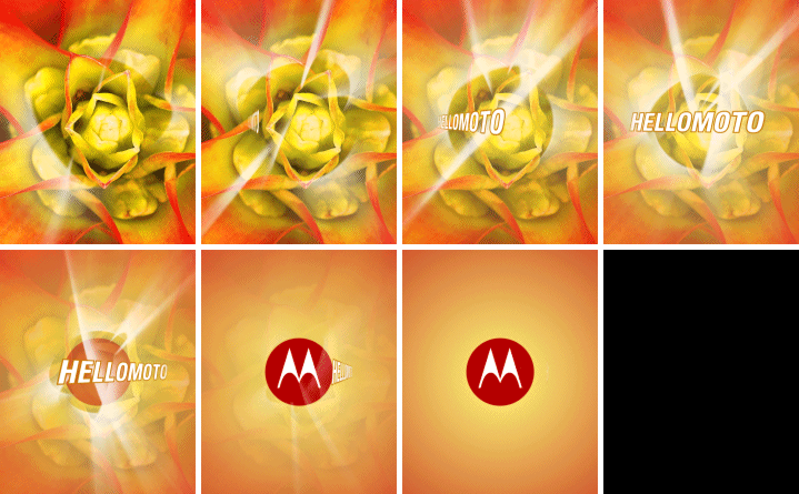
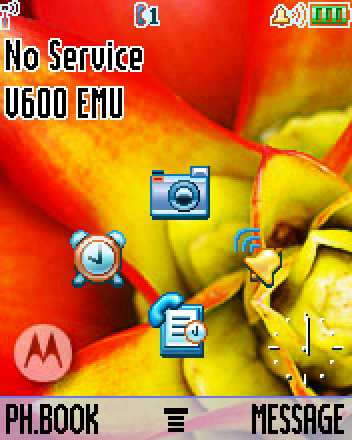
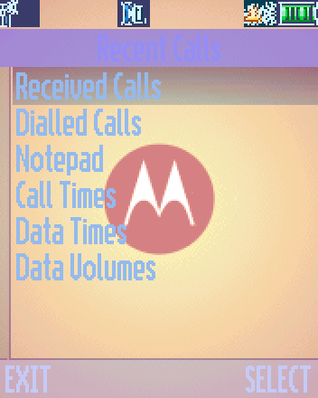

# V600 emulator

A low-level emulator for the **Motorola V600** (2004), a flip phone I've always loved. This is a
passion project: the goal is to run the phone's real firmware, unmodified, and use it again on a
computer, from the boot animation through the menus.



## What works

- Real firmware (`TRIPLETS_G_0B.09.38R`) boots on an emulated big-endian ARM7TDMI (Neptune LTE
  baseband), through the full startup animation to the standby screen.
- Interrupt controller, timers, PCAP2 power chip (ADC, interrupts), battery ID chip (DS2502 over
  one-wire), keypad, flip sensor.
- ATI Imageon W2250 graphics: command ring and the 2D engine operations the UI uses (blits, fills,
  lines, mono glyph text).
- A virtual GSM SIM card on the emulated SIM interface: the phone completes SIM start-up,
  reaches the idle screen ("No Service") and its menus can be navigated.
- Runs in real time in a browser with clickable keys (`tools/live.py`).

| Idle | Menu | Screensaver |
|---|---|---|
|  |  |  |

## Running it

The firmware is not included. You need your own V600 firmware dump as a Motorola superfile at
`firmware/v600.shx`.

```bash
python3 -m venv .venv
.venv/bin/pip install -r requirements.txt
.venv/bin/python tools/live.py        # then open http://localhost:8600
```

Keyboard: digits, `*` `#`, arrows, Space = OK, Enter = green key, Esc = red key (hold to
switch off), F1/F2 = soft keys, M = menu.

Changes the phone makes to its flash (settings, contacts, messages) are saved to
`state/flash.bin` every few seconds and on exit, and restored next time. Start with
`--fresh` to boot the phone as shipped.

## Layout

- `v600/`: the machine (memory map, CPU loop, interrupts) and hardware models.
- `tools/`: live mode, tracers, disassembly and symbol helpers.
- `PLAN.md`: approach and progress log. `HARDWARE.md`: every register learned and how.

## Next

Remaining rendering issues (some dialog text, soft-key contrast), the outer display, sound.

This is an independent hobby project, not affiliated with or endorsed by Motorola.
